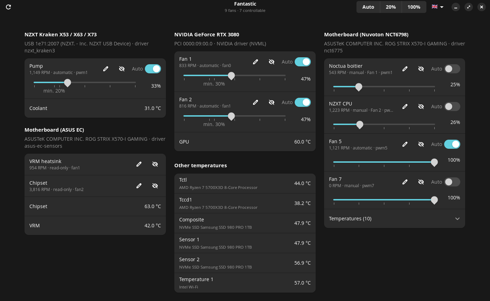

<div align="center">


# Fantastic

**Detect, identify and control your PC fans on Linux.**

[](docs/INSTALL.md)
[](https://www.python.org/)
[](https://gnome.pages.gitlab.gnome.org/libadwaita/)
[](#languages)
[](LICENSE)



</div>

## Why Fantastic?

On Linux, setting fan speeds often means editing files in `/sys`, running `pwmconfig`, or juggling several tools: one for the motherboard, one for the NVIDIA GPU, one for the liquid cooler. Fantastic brings everything together in a single window, with one slider per fan.

## Features

- 🔍 **Automatic detection** of every fan: motherboard, NVIDIA or AMD graphics card, AIO liquid cooler, USB controllers, laptops.
- 🏷️ **Clear identification**: device model ("NZXT Kraken X53", "GeForce RTX 3080", "ROG STRIX X570-I motherboard"…), USB/PCI bus and driver label. Every fan can be **renamed**.
- 🎚️ **A 0-100% slider** per fan, and an **Auto** switch to hand control back to the hardware.
- ⚡ **Auto / 20% / 100% buttons** to set every fan in one click.
- 🌡️ **Temperatures** shown next to the fans: CPU, GPU, coolant, SSD…
- 🖥️ **Adaptive layout**: devices spread over one, two or three columns depending on the window width.
- 🙈 **Hideable fans**: empty headers, tachometer-only cables… One click hides them, one button shows them all again.
- 🌍 **Five languages**: English, German, Spanish, French and Italian, switchable from the window.
- 💾 **Persistent settings**: reapplied at boot, after suspend or after a USB reconnection.
- 🛡️ **Built-in safety**: 100% when the CPU or GPU exceeds 90 °C, back to automatic when the service stops, hardware minimums enforced.
- 💡 **Hints** when fans exist but are invisible, for instance when the motherboard driver is not loaded.
- ⌨️ **Full command line** for scripts.
- 📦 **No exotic dependency**: Python and standard Ubuntu packages, nothing to install with pip.

## Supported hardware

Fantastic relies on the Linux kernel drivers (`/sys/class/hwmon`) and on NVML for NVIDIA.

| Hardware | Driver | Notes |
|---|---|---|
| Motherboard headers (CPU_FAN, CHA_FAN…) | `nct6775` (ASUS, MSI, ASRock), `it87` (Gigabyte) | The driver often has to be loaded once: `install.sh` takes care of it |
| NVIDIA graphics cards | NVML, proprietary driver ≥ 520 | One slider per GPU fan |
| AMD graphics cards | `amdgpu` | |
| NZXT Kraken X53/X63/X73, Z53/Z63/Z73, Kraken 2023/2024 | `nzxt_kraken3` | Pump: 20% minimum |
| NZXT Smart Device V2, RGB & Fan Controller | `nzxt_smart2` | |
| Corsair Commander Pro | `corsair_cpro` | |
| Aquacomputer D5 Next, Octo, Quadro | `aquacomputer_d5next` | |
| ThinkPad, Dell, ASUS laptops | `thinkpad_acpi`, `dell_smm_hwmon`, `asus_wmi` | Depending on the model |
| ASUS EC sensors (chipset, VRM) | `asus_ec_sensors` | Read-only |

More generally, any fan exposed by a hwmon driver with a `pwmN` file can be controlled.

## Installation

On Ubuntu 24.04 or newer, or a derivative (Pop!_OS, Linux Mint 22…):

```bash
git clone https://github.com/Radyum/Fantastic.git
cd Fantastic
sudo ./install.sh
```

Then open **Fantastic** from the applications menu. That's it.

📖 The **[installation guide](docs/INSTALL.md)** walks through every step. It also explains how to identify your fans, what to do when some are missing, and how to install on Fedora or Arch.

## Usage

### Graphical interface

| Action | Effect |
|---|---|
| Move a slider | The fan switches to manual at the chosen speed |
| Turn **Auto** on | The fan goes back to BIOS, graphics card or firmware control |
| **Auto / 20% / 100%** (top) | Sets every visible fan at once. **Auto** also includes hidden fans |
| ✏️ Pencil | Renames the fan ("CPU radiator", "Front intake"…) |
| Crossed-out eye | Hides the fan, without changing its setting. **Undo** stays available for a few seconds |
| 👁 *n* (top, when fans are hidden) | Shows every hidden fan again, after confirmation |
| Flag (top right) | Switches the interface language |
| ⟳ | Looks for new fans (after a `modprobe`, a USB connection…) |

The interface runs without root privileges, and your settings persist after the window is closed.

### Command line

```bash
fantastic                      # numbered list of fans
fantastic list -t              # … with temperatures
fantastic set 1 45             # fan #1 at 45%
fantastic set pump 60          # matched by part of the name
fantastic set all 100          # every visible fan at 100%
fantastic auto all             # everything back to automatic
fantastic rename 4 "CPU radiator"
fantastic hide 7               # hide a fan ("list --all" shows it again)
fantastic unhide all           # show every hidden fan again
fantastic detect               # detailed hardware inventory
fantastic list --json          # for scripts
```

In a script, prefer the stable identifier (`nct6798@nct6775.656/pwm2`) to the number, which can change when hardware appears.

## Languages

The interface is available in 🇬🇧 **English**, 🇩🇪 **German**, 🇪🇸 **Spanish**, 🇫🇷 **French** and 🇮🇹 **Italian**. Pick the language from the flag menu in the header bar; the choice is remembered in `~/.config/fantastic/settings.json`. By default, Fantastic follows the system language.

The command line follows the system language too (`LANG`, `LC_ALL`, `LANGUAGE`). `FANTASTIC_LANG` forces it (`en`, `de`, `es`, `fr` or `it`).

Adding a language takes one file: see [Contributing](#contributing).

## Safety

- **Thermal failsafe.** Above 90 °C on the CPU or GPU (configurable), manually set fans go to 100%. They return to their target once the temperature drops.
- **Back to automatic.** When the service stops (shutdown, update, `systemctl stop`), every fan returns to its original mode.
- **Hardware minimums.** Known limits are enforced automatically: 20% for a Kraken pump, the minimum declared by NVIDIA cards.
- **Permissions.** Anyone can read the state. Only authorized users (administrators, or users listed in the configuration) can change speeds.

> ⚠️ A fan at 0% stops spinning. Modern processors and graphics cards protect themselves by lowering their frequency, but avoid stopping the CPU fan.

## Configuration

The configuration file is `/etc/fantastic/config.json`. After a change, reload it with `sudo systemctl reload fantasticd`.

| Option | Default | Purpose |
|---|---|---|
| `allowed_users` | the user who installed | Users allowed to set speeds |
| `allowed_groups` | `sudo`, `wheel`, `admin`, `fantastic` | Allowed groups |
| `failsafe_temp` | `90` | Thermal failsafe threshold in °C (`null` disables it) |
| `failsafe_hysteresis` | `10` | Margin below the threshold to clear the failsafe |
| `poll_interval` | `2` | Monitoring interval (s) |
| `rescan_interval` | `15` | Interval between searches for new hardware (s) |
| `nvidia` | `true` | Use NVML for NVIDIA cards. Changing it requires `systemctl restart` |

## How it works

```
 ┌──────────────────────┐   Unix socket    ┌────────────────────────────┐
 │ fantastic gui (GTK4) │ ───────────────▶ │ fantasticd (root, systemd) │
 │ fantastic (CLI)      │  one JSON line   │  · targets + state         │
 └──────────────────────┘   per request    │  · thermal failsafe        │
       regular user                        │  · reapplication           │
                                           └─────────────┬──────────────┘
                         ┌───────────────────────────────┴──────────────────┐
                         ▼                                                  ▼
            /sys/class/hwmon/*/pwmN                       NVML (libnvidia-ml.so.1)
     motherboard, AMD, Kraken, Corsair…                     NVIDIA cards
```

Only the service needs root privileges, to write to `/sys` and to call NVML. The interface and the command line talk to it through a Unix socket. The service checks the identity of each client before accepting a speed change, and sends texts back in the language each client asks for.

| File | Role |
|---|---|
| [`fantastic/hwmon.py`](fantastic/hwmon.py) | Reading and driving hwmon chips |
| [`fantastic/nvidia.py`](fantastic/nvidia.py) | Minimal ctypes binding to NVML |
| [`fantastic/identify.py`](fantastic/identify.py) | Readable names: chips, USB/PCI, DMI, `pci.ids` |
| [`fantastic/hardware.py`](fantastic/hardware.py) | Unified inventory and hints |
| [`fantastic/daemon.py`](fantastic/daemon.py) | Service: socket, permissions, state, thermal failsafe |
| [`fantastic/gui.py`](fantastic/gui.py) | GTK 4 / libadwaita interface |
| [`fantastic/cli.py`](fantastic/cli.py) | Command line |
| [`fantastic/i18n.py`](fantastic/i18n.py), [`fantastic/translations/`](fantastic/translations) | Translations |

## Development

There is nothing to install: everything runs from the repository.

```bash
python3 -m unittest discover -s tests       # tests on a simulated /sys, without touching the hardware
python3 -m fantastic detect                 # real detection, read-only

# Development service on a temporary socket:
sudo python3 -m fantastic daemon --socket /tmp/fantastic.sock --state /tmp/fantastic-state.json -v
FANTASTIC_SOCKET=/tmp/fantastic.sock python3 -m fantastic gui

python3 tools/screenshot.py --lang en       # regenerates docs/screenshot.png
```

Technical notes for picking up the project live in [`AGENTS.md`](AGENTS.md): driver quirks, protocol, conventions.

## Roadmap

- [ ] Custom speed/temperature curves, per fan
- [ ] Support for USB devices without a kernel driver through [liquidctl](https://github.com/liquidctl/liquidctl)
- [ ] Assistant to identify motherboard headers
- [ ] `.deb` / Flatpak package

## Contributing

Is your hardware missing or poorly recognized? Open an issue with the output of `fantastic detect` and your motherboard model. Mappings from chips to readable names live in [`fantastic/identify.py`](fantastic/identify.py) and are easy to extend.

**Translations** are welcome. English is the source language. To add one:

1. copy [`fantastic/translations/fr.py`](fantastic/translations/fr.py) to `xx.py` and translate the values;
2. register it in `LANGUAGES`, `CATALOGS` and `SINGULAR` in [`fantastic/i18n.py`](fantastic/i18n.py).

`tests/test_i18n.py` checks that no message is missing.

## License

[MIT](LICENSE)
